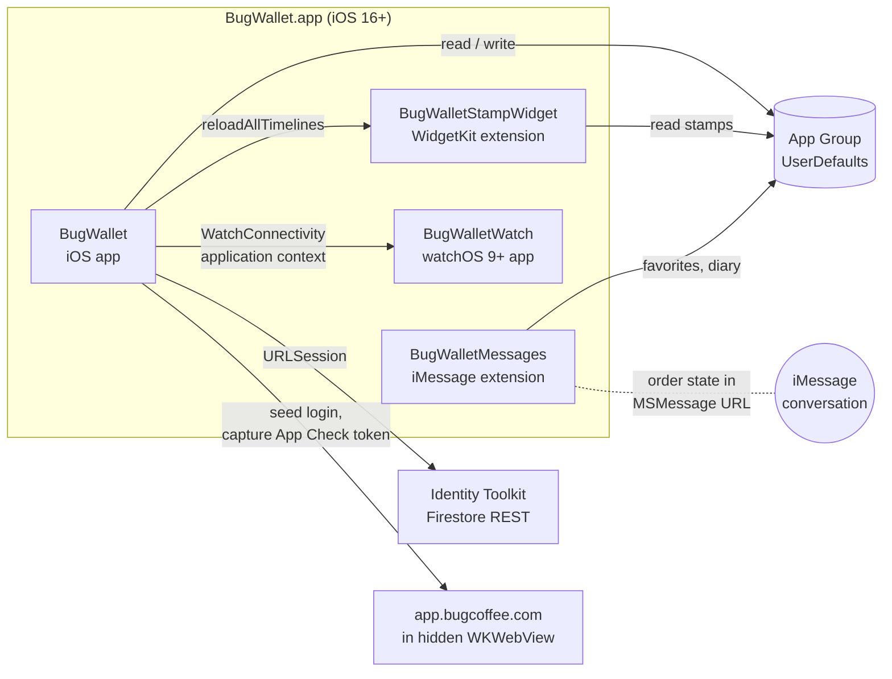

# 10 — Architecture of the iOS reference app

How the code in this repository is put together: the targets, what each one compiles, where
state lives, and how the pieces talk to each other. Docs 1–9 describe *what* the product does
in platform-neutral terms; this one describes *how the iOS implementation is structured*, for
someone about to change it.

Reference: `project.yml` (the source of truth for targets), `BugWallet/Sources`, `Shared`,
`MessagesExtension`, `StampWidget`, `BugWalletWatch`.

---

## 1. At a glance

- **Four shipping targets, one bundle.** An iOS app that embeds a watchOS app, a WidgetKit
  extension and an iMessage extension.
- **No server of our own and no Firebase SDK.** The app makes two kinds of network call, both
  plain `URLSession`: Identity Toolkit sign-in and (conditionally) one Firestore document read.
  A hidden `WKWebView` running the shop's web app supplies the App Check token for the latter
  (doc 2 §5).
- **No framework target.** Code is shared by compiling the same `Shared/` source files into
  each target that needs them.
- **SwiftUI throughout**, UIKit only where the system requires it (Messages view controller,
  PassKit, camera, share sheet, `WKWebView`).
- **State is small and local**: one `Session` object for identity, a handful of
  `UserDefaults`-backed stores, and per-screen `ObservableObject` models.
- **Two third-party packages**, both Apple's (`swift-certificates`, `swift-crypto`), linked
  only into the app and used only by on-device pass signing.

---

## 2. Targets



| Target | Type | Compiles | Entitlements | Notes |
|--------|------|----------|--------------|-------|
| `BugWallet` | iOS app | `BugWallet/Sources`, all of `Shared`, `PassTemplate` images as resources | App Group, HealthKit | Embeds the three targets below. Links `X509` and `_CryptoExtras`. |
| `BugWalletStampWidget` | app extension | `StampWidget/Sources`, all of `Shared` | App Group | Only uses `StampStore`, `StampCardView`, `BugBrand`. |
| `BugWalletMessages` | iMessage extension | `MessagesExtension/Sources`, all of `Shared` | *(none wired — see §10)* | Reuses the menu, favorites, diary and `BlendFinderView`. |
| `BugWalletWatch` | watchOS app | `BugWalletWatch/Sources`, **five** `Shared` files, plus `BugWallet/Sources/HealthLogger.swift` | HealthKit | Explicit file list: some shared SwiftUI doesn't build on watchOS. |
| `BugWalletTests` | unit tests | `BugWalletTests` | — | Hosted in `BugWallet`, `@testable import`. |
| `BugWalletMessagesTests` | unit tests | its own tests + the extension's three model files + two `Shared` files | — | No host: an extension can't host tests. |
| `BugWalletUITests`, `BugWalletWatchUITests` | UI tests | screenshot tests | — | Write `docs/screenshots/` (doc 9). |

The `.xcodeproj` and the `.entitlements` files are **generated** by XcodeGen from
`project.yml`. Add files by dropping them in a source folder and regenerating; add
capabilities in the YAML.

### 2.1 What `Shared/` contains

| File | Contents | UI? | On watch |
|------|----------|:---:|:--------:|
| `SharedKeys.swift` | Every defaults key, the watch payload keys, the App Group id, `groupDefaults` | – | ✓ |
| `CoffeeMenu.swift` | `MenuItem`, `CoffeeMenu` (static data), `Price`, `FavoritesStore` | – | ✓ |
| `BlendData.swift` | `BlendInfo`, `BrewMethod`, `BrewPlace`, `TastingEntry`, `BlendEntry`, `BlendJournal`, `BlendMatcher` | – | ✓ |
| `StampCard.swift` | `BugBrand`, `StampStore`, `StampCardView`, `SlotJitter` | ✓ | ✓ |
| `ImageDecode.swift` | PNG → `CGImage` via ImageIO | – | ✓ |
| `BeanLink.swift` | `bugcoffee://bean/<id>` encode/decode | – | – |
| `BlendFinder.swift` | `BlendFinderView`, the quiz UI (uses `.segmented`) | ✓ | – |

Rule of thumb: anything two targets must agree on — ids, keys, scoring, formatting, the stamp
jitter — belongs here, and should stay free of target-specific imports.

---

## 3. Layers inside the app

There is no formal architecture framework. The app target follows one consistent shape:

```
View (SwiftUI struct)
  └─ Model (@MainActor ObservableObject, one per screen)      ← unit tested
       └─ Service (caseless enum of static funcs, or a singleton)
            └─ Store (UserDefaults) / system framework / network
```

| Layer | Types | File |
|-------|-------|------|
| Entry + routing | `BugWalletApp`, `Session`, `RootView` | `BugWalletApp.swift` |
| Screens | `LoginView`, `CardView`, `ProductsView`, `BeanDetailView`, `TastingEditor` | `LoginView.swift`, `CardView.swift`, `ProductsView.swift` |
| Screen models | `LoginModel`, `CardModel`, `DiaryModel` | same files as their views |
| Layout helpers | `FittingScrollView`, reserved-region modifiers | `AdaptiveLayout.swift` |
| Network | `FirebaseAuth` (sign-in), `StampWebSync` (live stamp count) | `FirebaseAuth.swift`, `StampWebSync.swift` |
| Device links | `WatchSync` (phone → watch), `HealthLogger` (HealthKit) | `WatchSync.swift`, `HealthLogger.swift` |
| Wallet pass | `PassBuilder`, `PassSigner`, `PkPassZip`, `Zip`, `QRScannerView` | `PassBuilder.swift`, `PassSigner.swift`, `PkPassZip.swift`, `Zip.swift`, `LocalPassScanner.swift` |
| Rendering | `QRGenerator` (Core Image, level H) | `QRGenerator.swift` |
| Stores | `StampStore`, `FavoritesStore`, `BlendJournal` | `Shared/` |

Conventions that hold across the codebase:

- **Views own no logic worth testing.** Anything with a branch — sign-in round trip, stamp
  clamping, diary add/edit/delete — sits in the screen's model.
- **Stateless services are caseless enums** (`FirebaseAuth`, `HealthLogger`, `PassBuilder`,
  `QRGenerator`, the stores). Only the two things with a real lifecycle are singletons:
  `WatchSync.shared` and `StampWebSync.shared`.
- **Dependencies arrive as defaulted init/function parameters**, never through a container
  (§8).
- **Routing is two pieces of state in `RootView`**: `session.account` picks login vs. tabs, and
  `selectedBean` drives the Products split view. It lives that high so a deep link can set it
  before `ProductsView` exists.

The other targets are the same idea at smaller scale: `WatchModel` + four watch views;
`OrderStore` + `OrderViews` hosted by `MessagesViewController`; the widget is a
`TimelineProvider` and one view.

---

## 4. State and persistence

Everything persisted goes through `UserDefaults`, in two scopes (full key table: doc 3 §3).

| Scope | Holds | Owner |
|-------|-------|-------|
| `UserDefaults.standard` (per process) | UID, email, refresh token; on the watch also the QR PNG and stamp count | `Session` on the phone, `WatchModel` on the watch |
| App Group suite (`SharedKeys.groupDefaults`) | stamp count, favorites, tasting diary | `StampStore`, `FavoritesStore`, `BlendJournal` |

In memory:

- **`Session`** (`@StateObject` on the `App`, injected as an environment object) holds the
  optional `Account`. Setting it persists the identity, pushes it to the watch and starts the
  live stamp sync; `signOut()` reverses all three.
- **`StampWebSync.shared`** publishes `backendCount` and a diagnostic `status` string.
- **Screen models** hold only what their screen edits and re-read the stores on appear — the
  stores have no change notifications, so a view that can be stale (favorites toggled in the
  iMessage app) reloads in `onAppear`.

The watch has **no App Group**: its copy of the card arrives over WatchConnectivity and is kept
in its own standard defaults, so it works with the phone out of reach.

---

## 5. Runtime flows

### 5.1 Launch and sign-in

1. `Session.init` starts `WatchSync`, then looks for a saved UID.
2. If found, it rebuilds an `Account` (empty `idToken`, saved refresh token), re-pushes it to
   the watch and starts `StampWebSync`. `RootView` shows the tabs with **no network call** —
   the card works offline.
3. Otherwise `LoginView` → `LoginModel.signIn` → `FirebaseAuth.signIn` → `session.account =`,
   whose `didSet` runs the same persist-and-sync step.

### 5.2 The stamp count — one write path

The count has two sources and three displays, so every write funnels through the same two calls:

```
manual +/−  ─▶ CardModel.stamps ─┐
                                 ├─▶ StampStore.setCount  ─▶ App Group ─▶ widget reload
live count  ─▶ StampWebSync.apply┘   WatchSync.syncStamps ─▶ application context ─▶ watch
                     │
                     └─▶ backendCount ─▶ CardModel adopts it (backend wins)
```

`StampStore` clamps to 0…9 on both read and write and calls
`WidgetCenter.reloadAllTimelines()`; the widget's timeline is a single `.never` entry, so that
reload is the only thing that ever refreshes it.

### 5.3 Live stamp count (`StampWebSync`)

Firestore is App Check-gated with a web-only provider, so the app borrows a token from the real
web app (the options and the reasoning are in doc 2 §5):

1. A 1×1, near-transparent `WKWebView` is attached to the key window (a detached one gets its
   timers throttled) and loads `app.bugcoffee.com/app`.
2. A document-start user script seeds the account's Firebase auth record into the page's
   IndexedDB, posts `seeded`, and Swift reloads the page **once** so the web SDK boots signed in.
3. The same script hooks `fetch` and `XMLHttpRequest`, and posts the `X-Firebase-AppCheck`
   header and bearer token it sees on the page's own Firestore traffic.
4. Swift does a native REST read of `user-stamps/<uid>` with those two headers.
5. Fallback: the script also scans Firestore responses for `stamps_count` and posts it, so a
   refused native read still updates the card.

With no refresh token (or any failure) nothing happens and the manual count stays authoritative.

### 5.4 Phone → watch

One-way, latest-value-wins `updateApplicationContext`. `WatchSync` keeps the last full
dictionary and merges partial updates into it, because each call replaces the whole context.
The QR travels as PNG bytes — Core Image doesn't exist on watchOS. Details: doc 4 §4.

### 5.5 Deep link

`bugcoffee://bean/<id>` → `RootView.onOpenURL` → `BeanLink.bean(from:)` → switch to the Products
tab and set `selectedBean`. Unknown or retired ids are ignored.

### 5.6 Group order

The order is the message: `GroupOrder` round-trips through the `MSMessage` URL
(`?v=3&o=…`, doc 6), reusing the `MSSession` so updates replace one bubble.
`MessagesViewController` feeds the conversation to `OrderStore`, which splits the lines into
"mine" and "others" by `localParticipantIdentifier`; on submit it recombines them, renders the
bubble image with `OrderCardRenderer`, and inserts the message for the user to send.

### 5.7 Wallet pass

`PassBuilder` always can produce the **unsigned** pass (JSON + images) for signing on a Mac with
`Scripts/make_pkpass.sh`. Signing on the device — manifest, detached CMS signature via
`PassSigner`, root-level zip via `PkPassZip` — exists only in the `Debug-LocalPass`
configuration (§7), because it embeds the pass-signing private key in the bundle.

---

## 6. Boundaries between processes

| From → to | Mechanism | Payload |
|-----------|-----------|---------|
| App ⇄ widget, iMessage extension | App Group `UserDefaults` | stamps, favorites, diary JSON |
| App → widget | `WidgetCenter.reloadAllTimelines()` | — |
| App → watch | `WCSession.updateApplicationContext` | `uid`, `email`, `qr` (PNG), `stamps` |
| Device ⇄ device (group order) | `MSMessage.url` | whole order, versioned |
| Anything → app | URL scheme `bugcoffee://` | bean id |
| Page → app (`StampWebSync`) | `WKScriptMessageHandler` named `stampsync` | `seeded` / `appcheck` / `count` / `log` |
| App → network | `URLSession` | Identity Toolkit, Firestore REST |

The identifiers on these boundaries (keys, suite name, widget kind, link formats, menu ids) are
listed in doc 3 §6. Treat them as a public interface: changing one breaks installed data or
links already sent.

---

## 7. Build configurations and compile-time gates

| Gate | Where it's set | What it controls |
|------|----------------|------------------|
| `#if LOCAL_PASS_CREATION` | `Config/LocalPassCreation.xcconfig`, applied only to `Debug-LocalPass` (scheme `BugWallet-LocalPass`) | On-device pass signing, "Add to Apple Wallet", the QR scan-and-share flow. Compiled out of `Debug` and `Release`. |
| `#if compiler(>=6.4)` | Xcode version | iOS 27 SDK APIs (toolbar priorities and pinned placement in `ProductsView`). |
| `#if canImport(SwiftUI, _version: 8.0.85)` | SDK version | iOS 27.1 SDK APIs: `ArrangementView`, reserved regions for the fold and camera. |
| `#if canImport(WidgetKit)` | platform | Guards the widget reload in `StampStore`, which is compiled into every target. |

SDK-gated code is always gated **twice**: a compile-time check so older Xcodes still build, and
`#available` because the deployment target is iOS 16.

### 7.1 Adaptive layout

iPhone Duo support is layered on rather than forked:

- Screens pick an arrangement from `horizontalSizeClass` and the size `FittingScrollView` hands
  them, so one view serves iPhone, the Duo's two displays, Split View and iPad.
- `CardView` has three layouts: compact stack, a two-half `regularLayout`, and on iOS 27.1 an
  `ArrangementView` that splits exactly at the fold.
- Sheets, alerts and covers hang off the screen's root rather than a section, so they survive
  the compact ⇄ regular switch when the device opens or closes.
- `ProductsView` is a `NavigationSplitView`; it collapses to a push on compact width by itself.

---

## 8. Test seams

Unit tests run without network, Health prompts or real user data because each side effect has a
substitution point (how to run them: doc 8 §1.2).

| Dependency | Seam | Test double |
|------------|------|-------------|
| App Group defaults | `SharedKeys.groupDefaults` is a `var` | scratch suite |
| Session defaults | `Session(defaults:)` | scratch suite |
| Sign-in network | `FirebaseAuth.signIn(…, session:)` | `StubURLProtocol` |
| Firestore read, web origin, WebView config | `StampWebSync(origin:urlSession:configure:)` | stub session + `bugtest://` scheme handler |
| HealthKit | `CaffeineHealthStore` protocol | fake store |
| Health logging from the card | `CardModel(logDrink:)` closure | closure |
| Live count into the card | `CardModel(webSync:)`, `CardView(webSync:model:)` | test instance |

Tests that touch process-wide state are serialized under one suite; pure value tests run in
parallel.

---

## 9. Where things go

| You are adding… | Put it in… |
|-----------------|-----------|
| A menu item, bean profile, price rule | `Shared/CoffeeMenu.swift`, `Shared/BlendData.swift` — and never reuse or change an id |
| A persisted value | a key in `SharedKeys`, plus a small store enum next to its data; App Group only if another target reads it |
| A screen | a view + `@MainActor` model in `BugWallet/Sources`, routed from `RootView` |
| Something the watch also needs | a UI-light file in `Shared/`, **and** list it under the watch target in `project.yml` |
| A capability or entitlement | `project.yml`, then `xcodegen generate` |
| A newer-SDK API | behind both a compile-time gate and `#available` (§7) |

---

## 10. Known gaps

Things the structure currently gets wrong or leaves open — worth knowing before relying on them.

- **The iMessage extension's App Group entitlement is not wired.**
  `MessagesExtension/MessagesExtension.entitlements` declares the group, but `project.yml` has
  no `entitlements:` block for `BugWalletMessages`, so the generated project sets no
  `CODE_SIGN_ENTITLEMENTS` for it. Favorites and diary ratings are meant to be shared with the
  extension through the group; confirm on a device that they actually are.
- **The watch quiz is not personalized.** `BlendMatcher` reads `BlendJournal`, which on the
  watch resolves to an empty watch-local store — the diary is never synced over.
- **The refresh token is in plain `UserDefaults`**, not the keychain (doc 3 §3).
- **Brand colors are defined three times**: `BugBrand` (shared), private constants in
  `CardView`/`ProductsView`, and `Brand` in the iMessage views.
- **The group-order host is a placeholder** (`bugcoffee.example`).
- **`StampWebSync` depends on the web app's internals** — IndexedDB record shape, header names,
  response framing. A change on the shop's side silently degrades it to the manual count.
